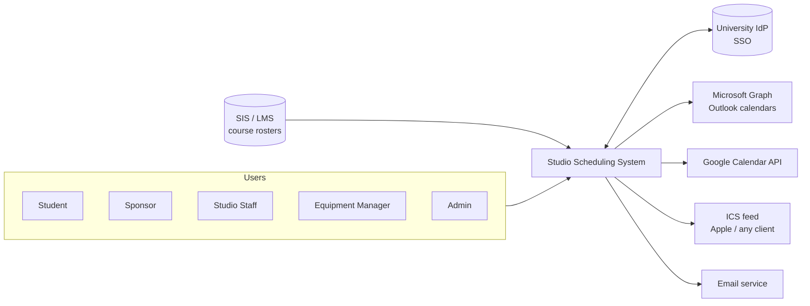
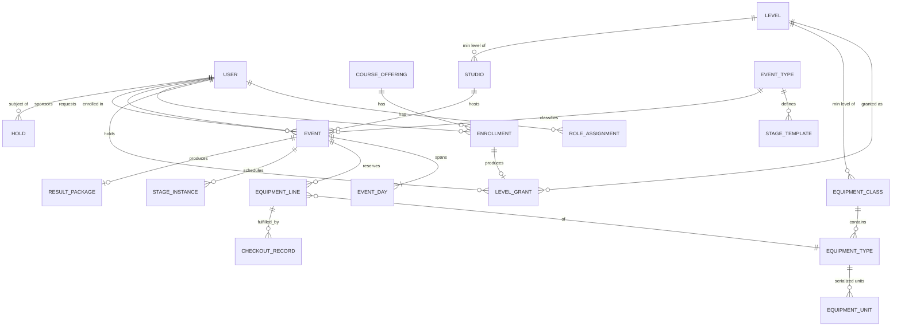
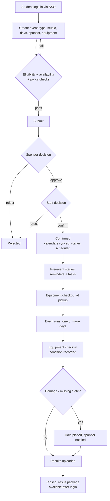

# Studio Scheduling System — Overview

Status: Draft v0.1 · Date: 2026-11-23

## 1. Purpose

A web application where university students request time in a studio, check out equipment for that time, receive reminders before the event, return equipment afterwards, and log in to retrieve their results. Each request needs a sponsor (faculty or staff), and studio staff confirm it.

## 2. Scope

In scope:

| Area | Spec |
|---|---|
| Login (SSO), roles, permissions | [F-001](F-001-identity-and-rbac.md) |
| Student levels, courses, equipment access | [F-002](F-002-levels-and-equipment-access.md) |
| Equipment inventory (quantity and status, per-item status) | [F-003](F-003-inventory.md) |
| Studios, hours, blackouts | [F-004](F-004-studios.md) |
| Event types, pre-event stages, reminder schedules | [F-005](F-005-event-types-and-reminders.md) |
| Event booking (single and multi-day), sponsor and staff approval | [F-006](F-006-event-booking-and-approval.md) |
| Equipment checkout, check-in, account holds | [F-007](F-007-equipment-checkout-and-checkin.md) |
| Post-event process and results retrieval | [F-008](F-008-post-event-and-results.md) |
| Calendar sync (Outlook, Google, Apple) | [F-009](F-009-calendar-sync.md) |
| Notification delivery (email, in-app) | [F-010](F-010-notifications.md) |
| Audit log and non-functional requirements | [90](90-non-functional.md) |

Out of scope (v1):

- Billing or charging students for damage or late returns (holds only).
- SMS and mobile push notifications.
- Equipment checkout that is not tied to an event.
- Recurring events (e.g. every Tuesday for 10 weeks).
- Two-way calendar sync and reading users' free/busy time.
- Native mobile apps (the web app must be responsive).
- Multiple campuses or time zones.

## 3. Decisions and assumptions

Each decision has a confidence that it matches what the university needs. Anything below 0.8 should be confirmed with stakeholders before build.

| ID | Decision | Source | Confidence |
|---|---|---|---|
| D-01 | **Roles** (what a user can do) and **Levels** (what equipment/studios a student can use) are separate concepts. | Agreed | 0.9 |
| D-02 | Levels are ranked. A level includes all equipment classes and studios of lower levels. | Agreed | 0.95 |
| D-03 | A level is granted either through course enrollment (expires at the course end date) or manually by staff (expiry optional, so it can be open-ended). | Agreed | 0.9 |
| D-04 | A student can hold several grants at once. Their effective level on a given day is the highest active grant. | Agreed | 0.9 |
| D-05 | A grant must cover every day of an event. When a grant expires or is revoked under a confirmed event, staff are asked to review; the event is not cancelled automatically. A warning goes out 7 days before expiry. | Agreed | 0.9 |
| D-06 | Levels also gate studio access. | Agreed | 0.95 |
| D-07 | Only Equipment Managers and Admins can grant or revoke levels and manage courses. | Agreed | 0.95 |
| D-08 | Calendar sync is push-only. Google and Microsoft use their APIs; Apple and any other client use an ICS subscription feed. This system is the source of truth. | Default accepted | 0.85 |
| D-09 | Login is via university SSO (OIDC or SAML 2.0) with just-in-time account creation. Entra ID is the reference IdP; SAML/Shibboleth must also work. | **Assumed** (question not answered) | 0.6 |
| D-10 | The sponsor is a faculty or staff user with the Sponsor role. They approve inside the app; email links lead to SSO login and then the approval page. They are notified of damage and late returns but are not financially liable. | **Assumed** | 0.6 |
| D-11 | "Results" means the event's **result package**: deliverable files or links uploaded after the event (recordings, exports), the equipment check-in report, and any sign-off. Requester, participants, sponsor, and studio staff can view it after login. Kept 365 days after the event closes. | **Assumed** (question not answered) | 0.5 |
| D-12 | Inventory supports both **serialized** equipment (each unit tracked) and **bulk** equipment (tracked by quantity). Unit statuses: `available`, `in_use`, `damaged`, `in_repair`, `lost`, `retired`. | **Assumed** (extended from "in use, repair, damaged") | 0.75 |
| D-13 | Approval chain: requester submits → sponsor approves → studio staff confirm. | Default accepted | 0.8 |
| D-14 | Multi-day events are a continuous run of days, each with its own time block. Equipment stays checked out overnight unless the event type says it must be returned daily. | Default accepted | 0.8 |
| D-15 | Each event type defines pre-event stages, either reminders or tasks. A required task that is not done blocks equipment checkout until staff override it. | Default accepted (the "blocking" part is assumed) | 0.7 |
| D-16 | Notifications go by email and in-app. Recipients are configured per stage. | Default accepted | 0.85 |
| D-17 | Booking rules: weekly hour cap per student, minimum and maximum notice before the event, blackout dates, opening hours. Staff can override with a recorded reason. | Default accepted | 0.85 |
| D-18 | A damage, loss, or late return places a hold on the student's account. The hold blocks new requests. No billing. | Default accepted | 0.85 |
| D-19 | Equipment can only be checked out for an event. | Default accepted | 0.9 |
| D-20 | Target: WCAG 2.1 AA, FERPA-aware handling of data, an audit log, a few thousand users, one campus time zone. | Default accepted | 0.85 |

## 4. Glossary

| Term | Definition |
|---|---|
| **User** | Anyone who logs in. Holds one or more roles. |
| **Role** | Set of system permissions: Student, Sponsor, Studio Staff, Equipment Manager, Admin. See F-001. |
| **Level** | Ranked access tier (e.g. L1 < L2 < L3). Unlocks equipment classes and studios at or below its rank. See F-002. |
| **Level Grant** | A student holding a level for a date range. Comes from a course enrollment or a manual grant. |
| **Course Offering** | A course in a term (e.g. FILM 201, Spring 2027) that grants a level to enrolled students until its end date. |
| **Equipment Class** | Group of equipment with a minimum level (e.g. "Cinema Cameras", min L3). |
| **Equipment Type** | A catalog entry inside a class (e.g. "Sony FX6"). Tracked either as serialized units or as a bulk quantity. |
| **Equipment Unit** | One physical serialized item, with an asset tag and its own status. |
| **Studio** | A bookable room with hours, a minimum level, and assigned staff. |
| **Event** | A booking: requester, sponsor, studio, event type, one or more Event Days, and equipment lines. |
| **Event Day** | One day's time block within an Event. A single-day event has exactly one. |
| **Event Type** | Template that sets allowed studios, duration limits, pre-event stages (reminder schedule), and post-event steps. |
| **Stage** | A pre-event step at an offset from the event start (e.g. T−7d). Either a *reminder* or a *task*. |
| **Requester** | The student who creates the event and is accountable for its equipment. |
| **Participant** | Another user listed on the event. Informational only; receives calendar entries and can see results. |
| **Sponsor** | Faculty or staff user who approves the event and is accountable for it academically. |
| **Hold** | Account flag that blocks a student from submitting new requests. |
| **Result Package** | Post-event deliverables plus the check-in report, available after login. |

## 5. System context

## 6. Domain model (overview)

The detailed fields are in each feature spec.

## 7. End-to-end lifecycle

## 8. Spec conventions

- Rule IDs: `BR-<feature>-<nn>`. User story IDs: `US-<feature>-<nn>`, each with acceptance criteria (AC) in Given/When/Then form.
- "Configurable" means an Admin can change it at runtime. The value given is the default.
- All times are stored in UTC and shown in the campus time zone (configured once).
- Each spec ends with an **Open questions** section. These must be answered before the spec can be considered final.

## 9. Open questions (cross-cutting)

| # | Question | Blocks |
|---|---|---|
| OQ-1 | What exactly are "results"? Media files, grades, sign-offs? Where are large files stored: here, or links to university OneDrive/Google Drive? | F-008 |
| OQ-2 | Which IdP and protocol does the university use? Does it release an affiliation attribute (student/faculty/staff)? | F-001 |
| OQ-3 | Is there an SIS/LMS API for rosters (Banner, Canvas, etc.), or will rosters be CSV imports? | F-002 |
| OQ-4 | Does the university run Microsoft 365 or Google Workspace? If so, a tenant-wide admin consent can replace asking each user to connect. | F-009 |
| OQ-5 | Are sponsors accountable for damage in any way beyond being notified? | F-007 |
