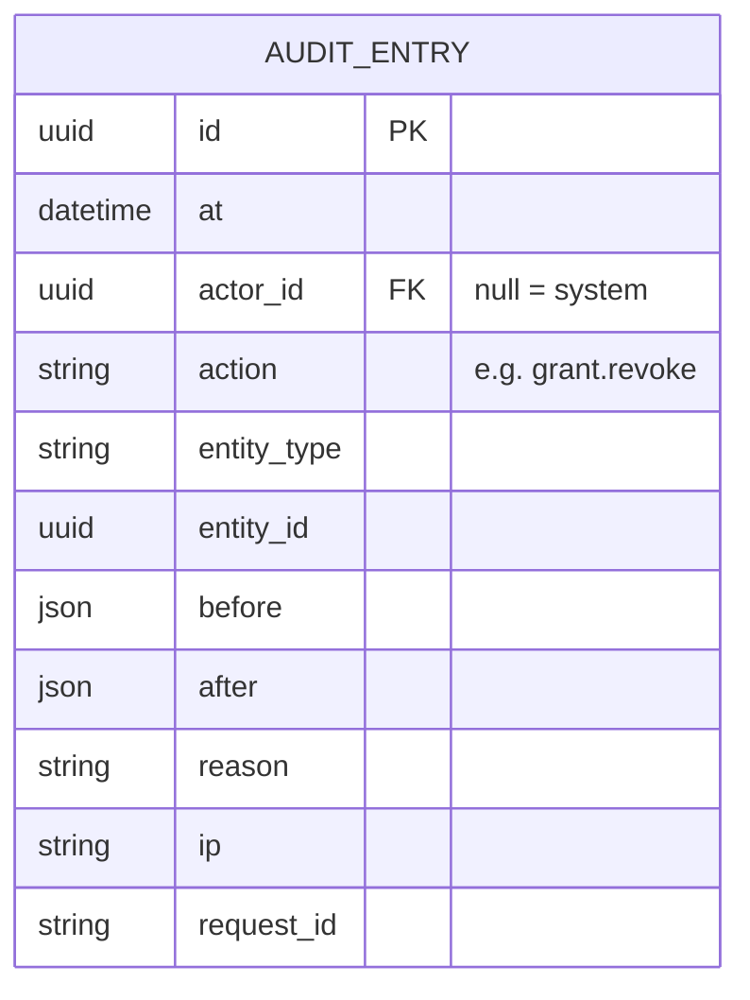

# 90 — Non-Functional Requirements and Audit

Status: Draft v0.1 · Applies to: all features

## 1. Targets

| Area | Requirement | Default |
|---|---|---|
| Users | Registered / concurrent | ~5,000 / 300 peak (start of term) |
| Performance | Page and API response, p95 | < 500 ms reads, < 1 s writes |
| Performance | Availability search (studio week + equipment) | < 1 s p95 |
| Availability | Uptime | 99.5% monthly. Planned maintenance announced 48 h ahead and kept outside 08:00–22:00 |
| Durability | Backups | Daily, 35-day retention, point-in-time recovery for the database. RPO 15 min, RTO 4 h |
| Time | Time zone | Store UTC. Show the single configured campus time zone. Handle DST changes in recurring daily reminders |
| Accessibility | Standard | WCAG 2.1 AA (also 2.2 AA where practical). Keyboard-only booking flow. Screen-reader-tested calendar grid |
| Browsers | Support | Latest 2 versions of Chrome, Edge, Firefox, Safari. Mobile Safari/Chrome; responsive layout down to 360 px |
| Language | Locale | English only in v1. Strings kept in resource files so they can be translated later |

## 2. Security and privacy

- **NFR-SEC-01** All traffic over TLS 1.2+. HSTS on.
- **NFR-SEC-02** Secrets and OAuth refresh tokens are encrypted at rest with a KMS key (BR-009-08).
- **NFR-SEC-03** Authorisation is checked on the server for every request, at object level (e.g. a student can only fetch their own events). Testing includes IDOR checks.
- **NFR-SEC-04** File uploads are virus-scanned and served from a separate domain/bucket through signed URLs (BR-008-10).
- **NFR-SEC-05** OWASP ASVS Level 2 is the baseline for verification. Dependencies are scanned in CI.
- **NFR-PRIV-01** **FERPA.** Course enrolment, levels, holds, and results count as education records. A user may see another student's records only with a legitimate need, as defined by the permission matrix (F-001 §3). Other students only ever see a busy/free studio grid.
- **NFR-PRIV-02** Data is minimised. From the IdP and SIS, only the fields in F-001/F-002 are stored. No grades are stored.
- **NFR-PRIV-03** Retention: results per BR-008-09. Event records kept 7 years (configurable, matching the university records schedule, OQ-90-1). Users who are disabled are anonymised after the retention period.

## 3. Audit log

- **NFR-AUD-01** Audited actions include: role assignment changes; grant create/revoke; level, course, and roster import; inventory status changes and adjustments; policy overrides; task overrides; staff and sponsor decisions; hold place/clear; event type, studio, and policy edits; template edits; integration settings; break-glass logins.
- **NFR-AUD-02** The audit log is append-only. The application's database role has no UPDATE/DELETE on it. It is kept for 7 years.
- **NFR-AUD-03** Admins can search the audit log and export CSV. Equipment Managers see only inventory, grant, and hold entries.

## 4. Operability

- **NFR-OPS-01** Background jobs (reminders, sync, notifications, auto-lost, grant expiry, retention) run on a durable queue. They are idempotent and retried with backoff, and jobs that keep failing go to a dead-letter queue that Admins can see.
- **NFR-OPS-02** Health dashboard for Admins: email bounce rate, calendar sync failures, broken connections, queue depth, overdue equipment count.
- **NFR-OPS-03** Structured logs carry a request id. No tokens or personal data beyond user ids appear in logs.
- **NFR-OPS-04** Separate dev, staging, and production environments. Staging uses synthetic data, never real student records.

## 5. Reporting (v1 minimum)

| Report | Audience |
|---|---|
| Studio utilisation by week, studio, event type | Admin |
| Equipment utilisation and damage/loss rate by type | Equipment Manager |
| Overdue and lost equipment | Equipment Manager, Studio Staff |
| Events per sponsor / course | Admin |
| No-shows and late returns per term | Admin |

All reports can be exported to CSV.

## 6. Open questions

- OQ-90-1: Which university records retention schedule applies to booking records?
- OQ-90-2: Where will it be hosted: university data centre, or cloud (with a FERPA-compliant vendor agreement)?
- OQ-90-3: Will the university's accessibility office run its own audit before launch?
