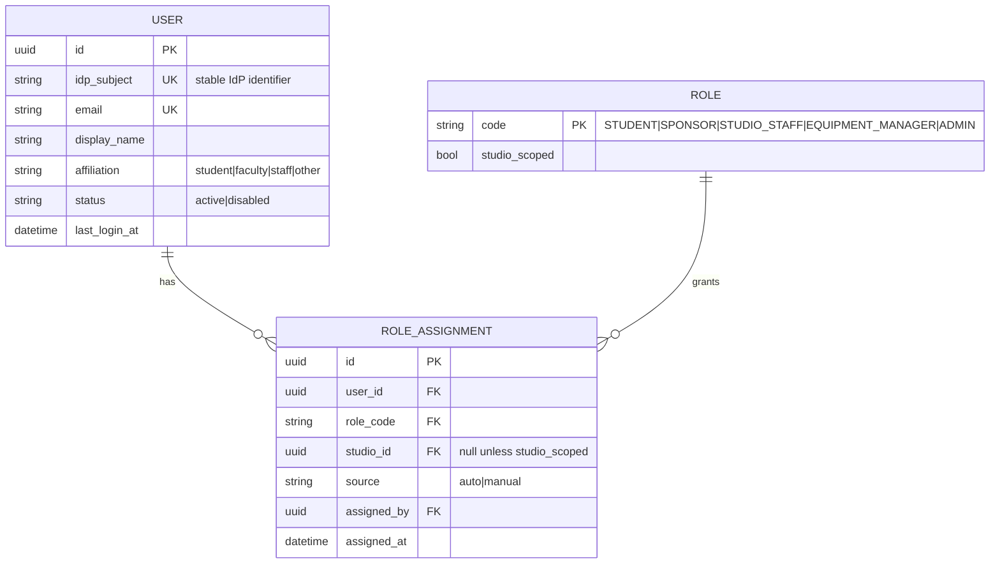
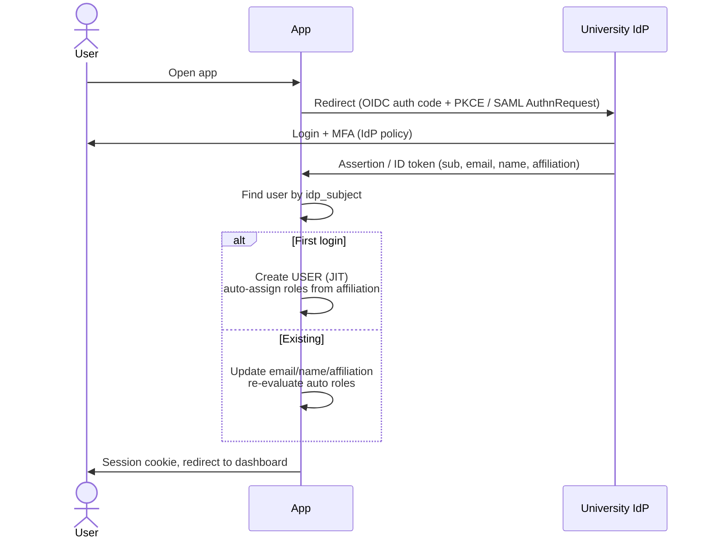

# F-001 — Identity and Role-Based Access Control

Status: Draft v0.1 · Depends on: — · Used by: all features

## 1. Purpose

Users log in with university SSO. Each user holds one or more roles, and each role grants a fixed set of permissions. Some roles are limited to specific studios. Roles do **not** control which equipment a student may use; that is done by Levels (F-002).

## 2. Roles

| Role | Who | Scope | Summary |
|---|---|---|---|
| Student | Enrolled students | Global | Request events, view own events, holds, results |
| Sponsor | Faculty / staff | Global | Approve or reject events they sponsor; view those events' results |
| Studio Staff | Technicians | Per studio | Confirm or reject events, check equipment out and in, upload results, manage stage tasks |
| Equipment Manager | Inventory leads | Global | Inventory, equipment classes, levels, courses, grants, holds |
| Admin | System owners | Global | Everything, including role assignment, event types, studios, policies, integrations |

A user may hold several roles (e.g. a grad student who is both Student and Studio Staff). Effective permissions are the union of all roles. Studio-scoped permissions apply only to the studios in that assignment.

## 3. Permission matrix

`●` = allowed · `○` = limited to own or sponsored records · `S` = limited to assigned studios · blank = denied

| Permission | Student | Sponsor | Studio Staff | Equip. Mgr | Admin |
|---|---|---|---|---|---|
| event.create | ● | | | | ● |
| event.view | ○ | ○ | S | ● | ● |
| event.edit (before confirmed) | ○ | | S | | ● |
| event.cancel | ○ | ○ | S | | ● |
| event.sponsor_decide | | ○ | | | ● |
| event.staff_decide | | | S | | ● |
| event.override_policy | | | S | | ● |
| stage.complete_task | ○ ¹ | ○ ¹ | S | | ● |
| stage.override_block | | | S | | ● |
| checkout.perform / checkin.perform | | | S | ● | ● |
| results.upload | ○ ² | | S | | ● |
| results.view | ○ | ○ | S | ● | ● |
| inventory.view | ● ³ | ● ³ | ● | ● | ● |
| inventory.manage | | | | ● | ● |
| unit.set_status | | | S ⁴ | ● | ● |
| level.manage / class.manage | | | | ● | ● |
| course.manage / roster.import | | | | ● | ● |
| grant.create / grant.revoke | | | | ● | ● |
| hold.view | ○ | ○ | S | ● | ● |
| hold.clear | | | | ● | ● |
| studio.manage | | | | | ● |
| event_type.manage | | | | | ● |
| policy.manage | | | | | ● |
| role.assign | | | | | ● |
| integration.manage | | | | | ● |
| audit.view | | | | ● ⁵ | ● |

¹ Only tasks whose stage template names that recipient role as the assignee.
² Only if the event type allows requester uploads (F-008).
³ Catalog view: types, classes, and availability. No asset tags or repair notes.
⁴ Only transitions done during check-in (F-007), e.g. `in_use → damaged`.
⁵ Only inventory, grant, and hold entries.

## 4. Data model

The permission-to-role mapping is fixed in code for v1 (not configurable). Changing it requires a release. Confidence 0.7 that this is acceptable; making it configurable roughly doubles the RBAC work.

## 5. Login flow

## 6. Business rules

- **BR-001-01** Login is via SSO only. There are no local passwords, except Admin break-glass accounts (BR-001-08).
- **BR-001-02** Users are identified by the IdP's stable subject identifier (`sub`, or the SAML persistent NameID), not by email, because email addresses can change.
- **BR-001-03** Automatic roles on login: affiliation `student` gets Student; `faculty` gets Sponsor; `staff` gets nothing automatically. Automatic roles have `source=auto` and are removed if the affiliation stops supporting them.
- **BR-001-04** Manual role assignments (`source=manual`) are never removed by login-time re-evaluation.
- **BR-001-05** Studio Staff assignments must name a studio. Every other role must not.
- **BR-001-06** There must always be at least one active Admin. The system rejects removing the last one.
- **BR-001-07** Every role assignment or removal is written to the audit log (actor, target, role, scope, timestamp).
- **BR-001-08** Up to 2 break-glass Admin accounts with local credentials and required TOTP MFA. Their logins alert all Admins.
- **BR-001-09** If the IdP reports an account as disabled, or it has not logged in for a configurable period (default 400 days), the user is set to `disabled`. Disabled users cannot log in, and their pending events are cancelled with notice to the sponsor.
- **BR-001-10** Sessions: idle timeout 60 min, absolute timeout 12 h (configurable).
- **BR-001-11** A user cannot sponsor or staff-confirm an event they requested, even if they hold those roles.
- **BR-001-12** Permission checks happen on the server for every request. Hiding something in the UI is not access control.

## 7. User stories

**US-001-01 — First login**
- AC1: Given a student with no account, when they complete SSO, then a USER is created and they hold the Student role.
- AC2: Given a faculty member with no account, when they complete SSO, then they hold the Sponsor role.
- AC3: Given an IdP response with no affiliation, when the user logs in, then they get no roles and see a "contact studio admin" page.

**US-001-02 — Admin assigns a studio-scoped role**
- AC1: Given an Admin, when they assign Studio Staff to a user for Studio A, then that user can confirm events in Studio A but not in Studio B.
- AC2: When an Admin tries to assign Studio Staff without a studio, the request is rejected with a validation error.

**US-001-03 — Separation of duties**
- AC1: Given a user who is both Student and Sponsor, when they request an event, they cannot choose themselves as sponsor.

**US-001-04 — Deprovisioning**
- AC1: Given a user disabled in the IdP, when the nightly sync runs (or they try to log in), then their status becomes `disabled` and pending events are cancelled with notifications.

## 8. Edge cases

- A user's affiliation changes from student to staff (a graduate becomes an employee). The automatic Student role is removed. The user's existing events, holds, and grants remain.
- The same person has two IdP identities (e.g. alumni and staff accounts). They are treated as two users; there is no merging in v1.
- Session expires while a long booking form is being filled in. The form draft is saved on the client and restored after re-login.

## 9. Open questions

- OQ-001-1: Does the IdP release `eduPersonAffiliation`, or an equivalent group claim?
- OQ-001-2: Should a sponsor be able to delegate approval to a TA?
- OQ-001-3: Is a nightly IdP deprovisioning feed (SCIM or similar) available, or only checks at login time?
