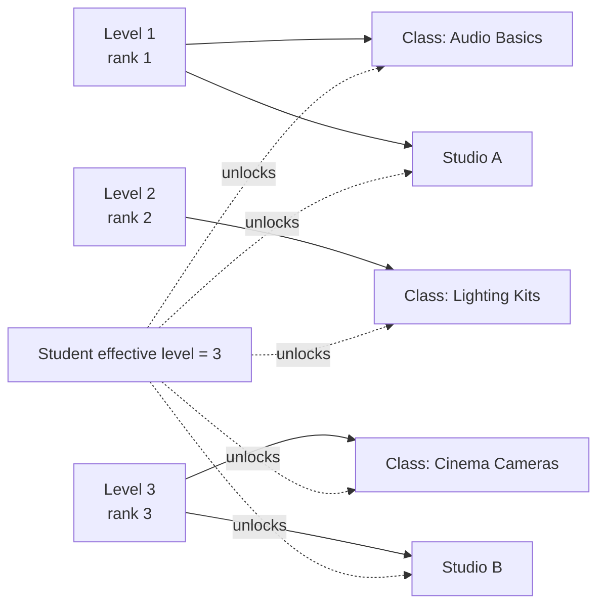
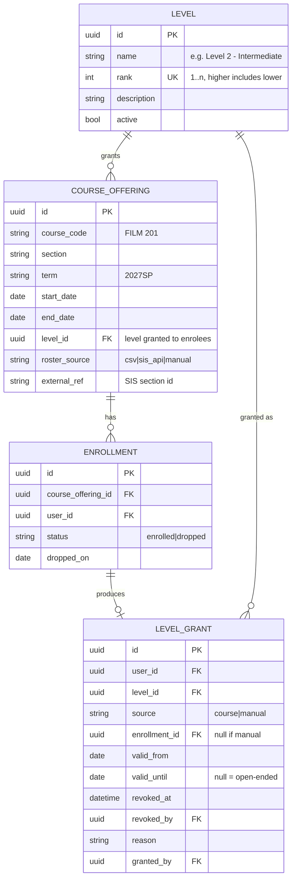
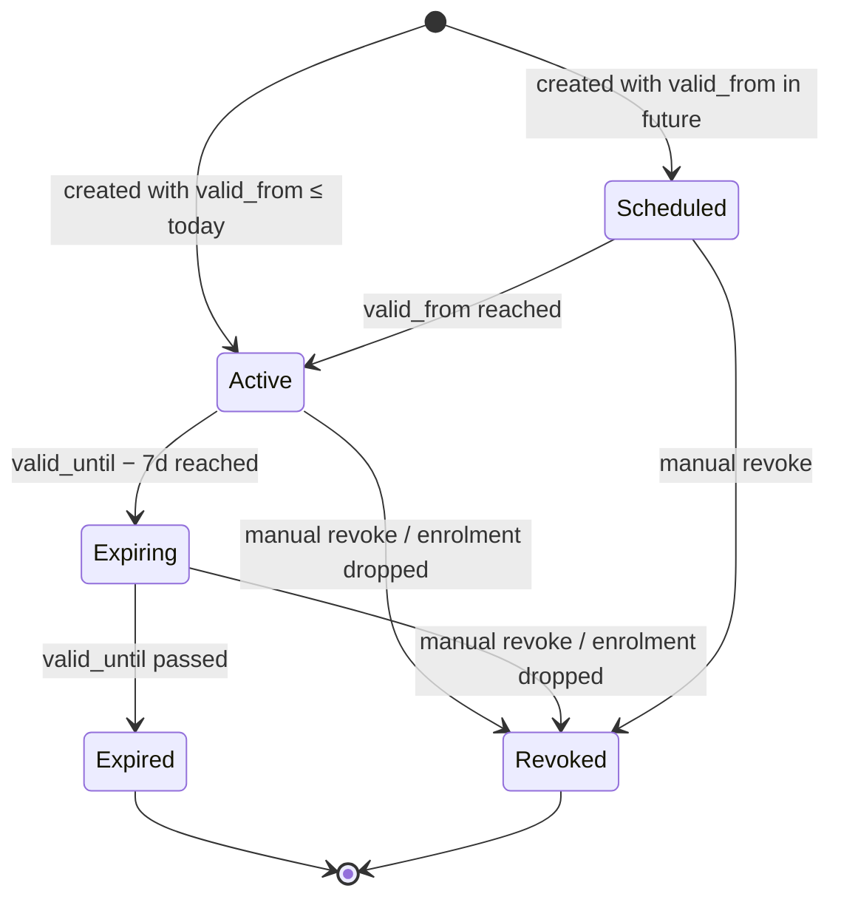
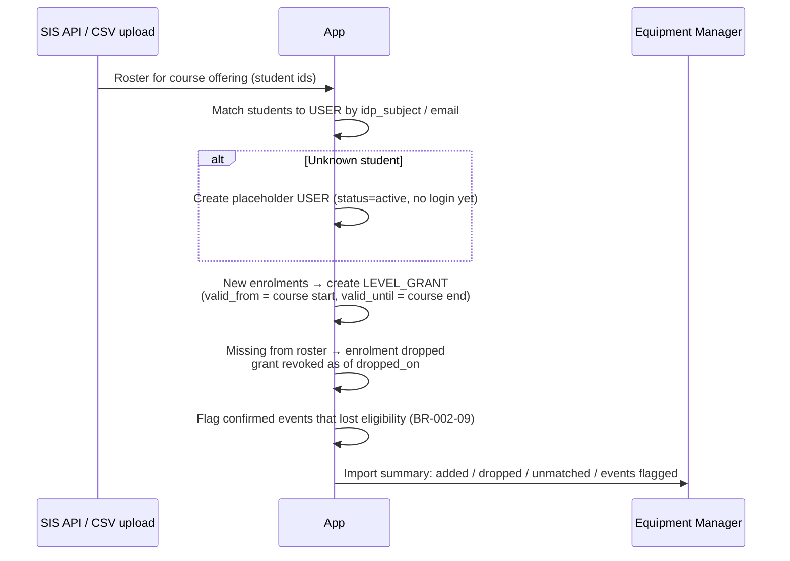

# F-002 — Levels, Courses and Equipment Access

Status: Draft v0.1 · Depends on: F-001 · Used by: F-003, F-004, F-006

## 1. Purpose

Decide which equipment and studios a student may book. Each student holds zero or more **level grants**. A grant comes either from enrolment in a course offering, which expires at the course's end date, or from a manual grant by an Equipment Manager/Admin, where the expiry date is optional. Levels are ranked, and a higher level includes everything unlocked by the levels below it.

## 2. Concepts



Each equipment class and each studio has one **minimum level**. A student may use a class or studio on a given day if their **effective level** on that day is at or above the minimum. Because the check is "rank ≥ minimum", higher levels automatically include lower ones (D-02).

## 3. Data model



## 4. Effective level

```
active(grant, d) = grant.valid_from ≤ d
                   AND (grant.valid_until IS NULL OR d ≤ grant.valid_until)
                   AND (grant.revoked_at IS NULL OR d < date(grant.revoked_at))

effective_level(user, d)   = max(rank of active grants on day d), or 0 if none
event_level(user, event)   = min over each event day d of effective_level(user, d)
eligible(user, event, X)   = event_level(user, event) ≥ X.min_level.rank
```

Taking the minimum over the event's days means a multi-day event must be covered by grants on **every** day. Different grants may cover different days (D-05).

## 5. Grant lifecycle



Open-ended grants (`valid_until = null`) stay `Active` until they are revoked.

## 6. Roster sync (course grants)



## 7. Business rules

- **BR-002-01** Level ranks are unique positive integers. Inserting a level between two others means renumbering ranks, and the system re-evaluates all future confirmed events afterwards (BR-002-09).
- **BR-002-02** Each equipment class and each studio has exactly one `min_level`.
- **BR-002-03** A course grant gets `valid_from = course.start_date` and `valid_until = course.end_date`. Its dates cannot be edited directly; they follow the course offering. Changing the course dates updates all of its grants.
- **BR-002-04** A manual grant needs a `reason`. `valid_until` is optional; leaving it empty makes the grant open-ended.
- **BR-002-05** Only Equipment Manager and Admin can create or revoke grants, manage levels and courses, or import rosters (D-07).
- **BR-002-06** A student may hold any number of grants at once, including several for the same level. Grants are combined by taking the maximum (D-04).
- **BR-002-07** Revoking a grant needs a reason and takes effect from the day it is revoked. Revoked grants are kept for audit and are never deleted.
- **BR-002-08** Roster import is idempotent. Importing the same roster twice changes nothing. A student who is dropped and then re-enrolled gets a new grant.
- **BR-002-09** **Eligibility re-check.** When a grant expires, is revoked, changes date, or level ranks change, the system re-runs `eligible()` for that student's events in states `Submitted` through `Confirmed` (F-006). Any event that fails gets `needs_review=true` with reason `ELIGIBILITY_LOST`. Studio staff and the sponsor are notified. The event is **not** cancelled automatically (D-05).
- **BR-002-10** **Expiry warning.** 7 days before `valid_until` (configurable), if the student has any event in the same states that the grant expiring would make ineligible, the student and the sponsor are notified. Grants that no event depends on expire without notice.
- **BR-002-11** The eligibility check happens when a request is submitted (F-006), when the sponsor approves, when staff confirm, and at equipment checkout (F-007).
- **BR-002-12** Each student can see their own grants: level, source course, and expiry. They cannot see other students' grants (FERPA, see 90-NFR).
- **BR-002-13** A level cannot be deactivated while active grants, classes, or studios refer to it.

## 8. User stories

**US-002-01 — Course grants a level**
- AC1: Given FILM 201 (Spring 2027, Jan 20–May 15) granting Level 2, when the roster is imported, then each enrolled student has a Level 2 grant valid Jan 20–May 15.
- AC2: Given that student requests an event on May 16 using Level 2 equipment, then submission is blocked with "Level 2 access ends May 15 (FILM 201)".

**US-002-02 — Manual open-ended grant**
- AC1: Given an Equipment Manager grants Level 3 to a student with no end date and reason "Senior thesis", then the student can book Level 1–3 equipment on any future date.

**US-002-03 — Levels add up**
- AC1: Given a student with Level 1 (Course A, ends May 15) and Level 3 (manual, ends Mar 1), when they request an event on Apr 1, then their effective level is 1.

**US-002-04 — Drop from course**
- AC1: Given a student with a confirmed event on Apr 10 that relies on their FILM 201 Level 2 grant, when the Mar 3 roster no longer lists them, then the grant is revoked as of Mar 3, the event is flagged `ELIGIBILITY_LOST`, and the studio staff and sponsor are notified.

**US-002-05 — Grant spans part of a multi-day event**
- AC1: Given a Level 3 grant ending May 15 and a 3-day event May 14–16 using Level 3 equipment, when it is submitted, then it is blocked, and the message names May 16 as the day without coverage.

## 9. Edge cases

- A roster lists a student who has never logged in. A placeholder user is created and matched by `idp_subject` on their first SSO login. If the only available identifier is email and it doesn't match, the import summary lists the student as unmatched.
- A course has no level (e.g. a theory class). Rosters are not imported for it.
- A grant expires in the middle of a multi-day event that is already checked out. The event is flagged for staff review. The equipment is **not** recalled automatically.
- Two grants for the same level with overlapping dates. This is allowed; the coverage is the union of the two.

## 10. Open questions

- OQ-002-1: Can a student hold a higher level than their courses give, permanently (e.g. a staff-certified operator)? Manual open-ended grants support this. Confirm whether there should be any limit.
- OQ-002-2: Should equipment-specific certifications (e.g. "trained on the jib arm") be added on top of levels? Not in v1.
- OQ-002-3: Should roster sync run on a schedule (nightly from the SIS), or only when someone triggers it?
