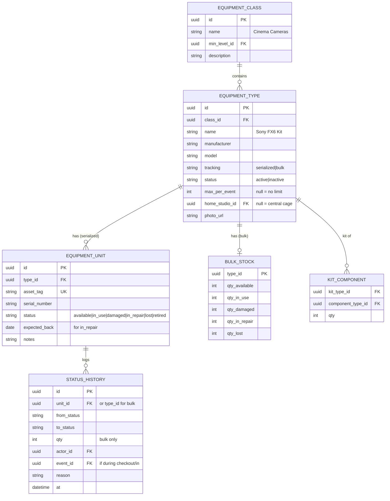
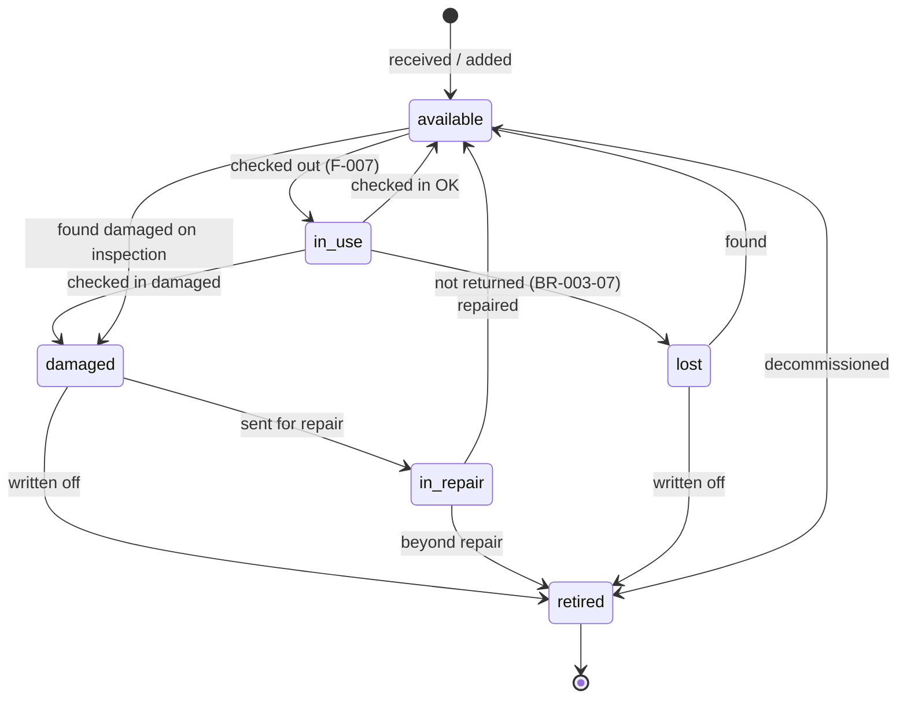

# F-003 — Equipment Inventory

Status: Draft v0.1 · Depends on: F-001, F-002 · Used by: F-006, F-007

## 1. Purpose

Keep a catalog of equipment, how many of each item exist and in what condition, and whether it is available for a given date range. Equipment comes in two kinds (D-12):

- **Serialized**: each physical unit is tracked separately, with an asset tag, a serial number, and its own status. Examples: cameras, microphones, lenses.
- **Bulk**: only quantities are tracked, split by status. Examples: XLR cables, sandbags, gaffer tape.

## 2. Data model



The total quantity for a type is the count of its units that are not `retired` (serialized), or the sum of its `qty_*` columns (bulk). It is computed, not stored.

`EQUIPMENT_TYPE.status` is the catalog status: `inactive` hides the type from new requests without changing its stock. Unit status is a separate thing that describes physical condition.

## 3. Unit status lifecycle

The same state machine applies to a serialized unit and to each quantity moved between bulk buckets.



| Status | Meaning | Counts toward bookable capacity? |
|---|---|---|
| available | On the shelf, working | Yes |
| in_use | Checked out to an event | Yes. It is expected back, and future overlaps are prevented by reservations (§4). |
| damaged | Returned or found damaged, not yet assessed or sent out | No |
| in_repair | Being repaired | Only for windows starting after `expected_back` + 1 day |
| lost | Not returned / missing | No |
| retired | Permanently out of service | No (excluded from the total) |

## 4. Availability

Availability is calculated for a time window, not stored.

```
capacity(type, window)  = units/qty counting toward capacity for that window (table above)
reserved(type, window)  = Σ equipment_line.qty for events whose days overlap the window
                          (after the turnaround buffer) and whose state holds stock (F-006 §4)
available(type, window) = capacity − reserved
```

For a multi-day event, the window is from the first day's start to the last day's end, because equipment stays out overnight by default (D-14). If the event type requires daily returns, each day is checked separately.

## 5. Business rules

- **BR-003-01** Every type belongs to exactly one class. The class decides the minimum level (F-002).
- **BR-003-02** A type's `tracking` mode cannot change once it has units or stock. To change it, retire the type and create a new one.
- **BR-003-03** Asset tags are unique across all equipment. They are printed as barcodes or QR codes for scanning at checkout.
- **BR-003-04** Every status change records actor, from, to, reason, and the event if any. Changes are append-only (audit).
- **BR-003-05** Inventory edits (create/edit/retire types and units, adjust bulk quantities) need the Equipment Manager or Admin role. Studio Staff may only make the status changes that happen during checkout and check-in (F-001 ⁴).
- **BR-003-06** **Kits.** A kit type (e.g. "FX6 Kit") lists component types. Reserving a kit reserves its components. At checkout, staff scan each serialized component. A kit's level is the highest minimum level among its components and its own class.
- **BR-003-07** A unit that is still `in_use` a configurable number of days after its event's check-in deadline (default 7) is automatically set to `lost`, and a hold is placed (F-007).
- **BR-003-08** Moving units into `damaged`, `lost`, or `retired` re-runs availability for future events that reserved that type. Any event whose reservation can no longer be met is flagged `needs_review` with reason `EQUIPMENT_SHORTAGE` (F-006).
- **BR-003-09** Bulk adjustments (stock counts, receiving new stock) need a reason and are recorded as status history with `qty`.
- **BR-003-10** `max_per_event` caps how many of a type one event may reserve. Staff can override it with a reason.
- **BR-003-11** Students and sponsors see the catalog: class, type, photo, and availability for chosen dates. Asset tags, serials, repair notes, and the status of individual units are visible to staff roles only.

## 6. User stories

**US-003-01 — Add serialized units**
- AC1: Given an Equipment Manager, when they add 4 units of "Sony FX6 Kit" with asset tags, then the type's capacity is 4 and each unit is `available`.

**US-003-02 — Mark a unit for repair**
- AC1: Given unit FX6-03 `damaged`, when the manager moves it to `in_repair` with expected_back = Mar 20, then requests for windows starting Mar 21 or later count it as capacity, and earlier windows do not.

**US-003-03 — Damage affects future events**
- AC1: Given 2 FX6 units and two confirmed events on Apr 5 each reserving 1, when one unit is marked `damaged`, then the later-created of the two events is flagged `EQUIPMENT_SHORTAGE` and its studio staff are notified.

**US-003-04 — Student browses catalog**
- AC1: Given a Level 2 student who picked dates, when they browse, then they see Level 1–2 types with availability counts. Level 3 types are either hidden or shown locked with the reason "Requires Level 3" (UI decision OQ-003-2).

## 7. Edge cases

- Bulk return counts don't add up (5 out, 3 returned OK, 1 damaged, 1 not returned). The missing 1 moves from `in_use` to `lost` after the BR-003-07 window, unless it is found first.
- A unit is retired while it is reserved but not yet checked out. BR-003-08 handles it.
- The same equipment is stored in different studios. v1 has no location transfers: `home_studio_id` is informational, and all equipment is one shared pool. OQ-003-1.

## 8. Open questions

- OQ-003-1: Is there one equipment pool, or does each studio have its own stock that cannot be shared?
- OQ-003-2: Should equipment above a student's level be hidden, or shown as locked?
- OQ-003-3: Should replacement value be stored per type, for damage reports, even though billing is out of scope?
- OQ-003-4: Should there be periodic stock-take (cycle count) workflows?
