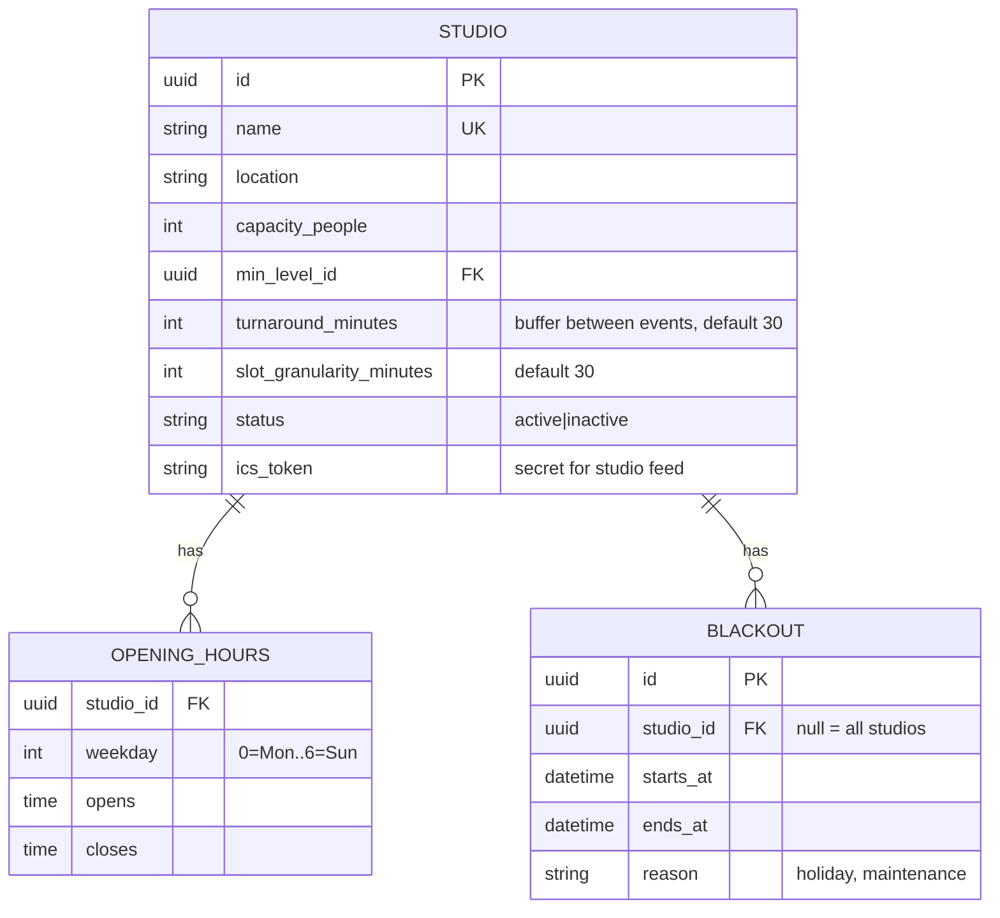
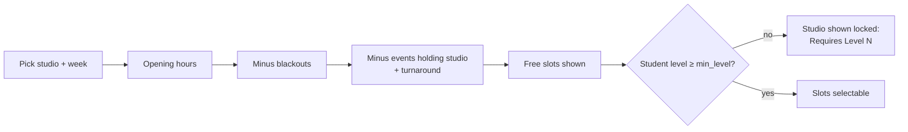

# F-004 — Studios

Status: Draft v0.1 · Depends on: F-001, F-002 · Used by: F-005, F-006, F-009

## 1. Purpose

Define the rooms that can be booked: when each is open, which level a student needs to book it, when it is closed (blackouts), the cleanup time between bookings, and which staff work there.

## 2. Data model

Staff are linked to a studio through a `ROLE_ASSIGNMENT` with role Studio Staff (F-001).

## 3. Business rules

- **BR-004-01** An event day must fit entirely inside that studio's opening hours for that weekday. A day can have several opening-hour rows (e.g. 08:00–12:00 and 13:00–22:00); the event day must fit inside one of them.
- **BR-004-02** An event day must not overlap any blackout for that studio or for all studios.
- **BR-004-03** Event days in the same studio must not overlap, counting `turnaround_minutes` added after each one. Events in states that hold the studio (F-006 §4) count.
- **BR-004-04** Start and end times must line up with `slot_granularity_minutes`.
- **BR-004-05** The requester must meet `min_level` on every event day (F-002 `eligible`).
- **BR-004-06** Adding a blackout that overlaps events that already hold the studio flags those events `needs_review` with reason `STUDIO_BLACKOUT` and notifies staff. They are not cancelled automatically.
- **BR-004-07** Shortening opening hours or raising `min_level` re-checks future events the same way (reasons `OUTSIDE_HOURS`, `ELIGIBILITY_LOST`).
- **BR-004-08** An inactive studio cannot be chosen for new requests. Existing events are flagged.
- **BR-004-09** Every studio publishes a read-only ICS feed of its events (F-009). Titles only; no student details unless the person subscribing is staff (the token is staff-only).
- **BR-004-10** Only Admins can create or edit studios, opening hours, and blackouts.

## 4. Availability view

Students see a week grid per studio: free slots, plus slots marked busy with no details of who booked them. Staff also see event titles and requesters.

## 5. User stories

**US-004-01 — Turnaround**
- AC1: Given Studio A with 30 min turnaround and an event ending 14:00, when a student requests a slot starting 14:00, then it is rejected, and 14:30 is offered as the earliest start.

**US-004-02 — Blackout added later**
- AC1: Given a confirmed event on Dec 22, when an Admin adds a Dec 20–Jan 5 closure, then the event is flagged `STUDIO_BLACKOUT`, and the studio staff and requester are notified.

**US-004-03 — Level-gated studio**
- AC1: Given Studio B with min Level 3 and a Level 2 student, when they view Studio B, then it is shown locked and they cannot submit a request for it.

## 6. Open questions

- OQ-004-1: Can events go past midnight (overnight shoots)? v1 assumes no. Every event day ends on the date it starts.
- OQ-004-2: Can one event book more than one studio at the same time?
- OQ-004-3: Do some studios need staff present during the session? If so, staff availability becomes a scheduling limit, which v1 does not model.
