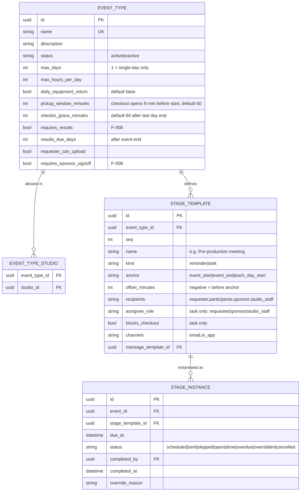
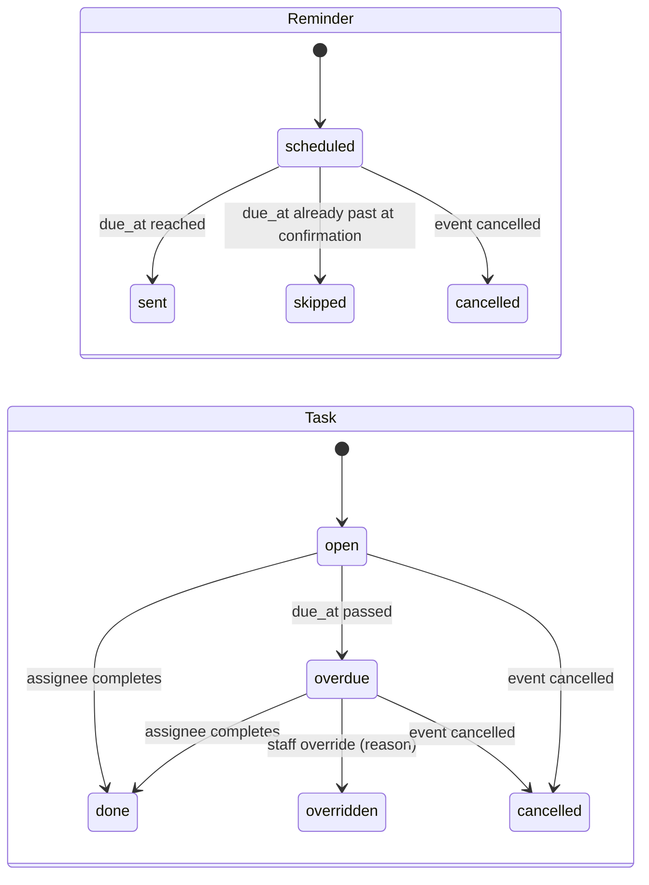
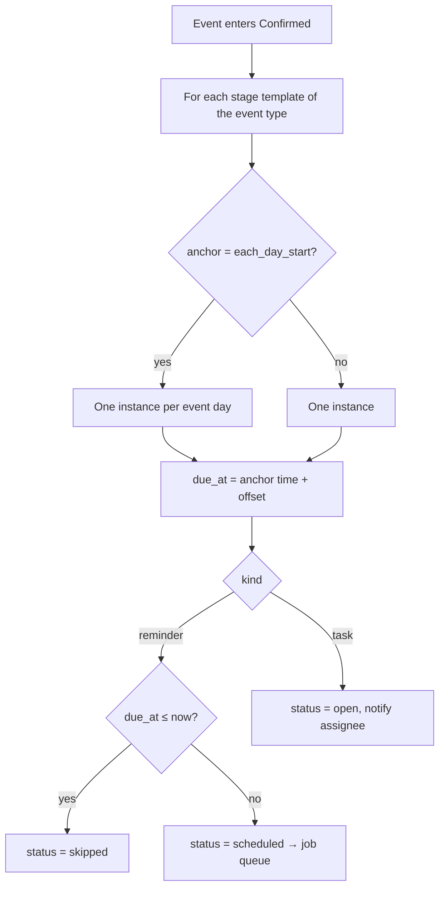

# F-005 — Event Types, Pre-Event Stages and Reminders

Status: Draft v0.1 · Depends on: F-001, F-004 · Used by: F-006, F-007, F-008, F-010

## 1. Purpose

An **event type** is a template that controls how its events behave:

- which studios it can use, and its duration limits;
- its **pre-event stage schedule**: reminders and tasks at set offsets before the event starts;
- its **post-event steps**: check-in deadline, results upload, sponsor sign-off (F-008).

Admins manage event types. Examples: "Class Project Shoot", "Podcast Recording", "Thesis Production".

## 2. Data model

## 3. Example reminder schedule ("Thesis Production")

| Seq | Stage | Kind | Anchor / offset | Recipients | Blocks checkout |
|---|---|---|---|---|---|
| 1 | Booking confirmed summary | reminder | event_start −14d | requester, sponsor | — |
| 2 | Submit shot list | task (requester) | event_start −7d | requester | No |
| 3 | Safety briefing acknowledged | task (requester) | event_start −3d | requester, studio_staff | **Yes** |
| 4 | Tomorrow: pickup details | reminder | event_start −1d | requester, participants | — |
| 5 | Equipment ready for pickup | reminder | event_start −1h | requester | — |
| 6 | Daily start reminder | reminder | each_day_start −1h | requester, participants | — |
| 7 | Return equipment | reminder | event_end −30m | requester | — |

## 4. Stage instance lifecycle

A task opens as soon as the event is confirmed, so it can be completed early. Its `due_at` is the deadline. Recipients get a notification when the task opens, and again at `due_at` if it is still not done.

## 5. Scheduling algorithm

## 6. Business rules

- **BR-005-01** Stage instances are created when an event is **Confirmed** (F-006), not when it is submitted.
- **BR-005-02** If an event is rescheduled (its days change), reminders that have not been sent and tasks that are not done are recalculated from the new anchors. Reminders already sent are not re-sent. Completed tasks stay completed.
- **BR-005-03** Cancelling an event cancels every stage instance that is still `scheduled`, `open`, or `overdue`.
- **BR-005-04** A reminder whose `due_at` has already passed when the event is confirmed is `skipped`, not sent late. The exception is the first stage: a booking confirmation is always sent immediately (F-010).
- **BR-005-05** At checkout (F-007), any task with `blocks_checkout=true` that is not `done` or `overridden` blocks the checkout. Studio Staff may override it with a reason, which is audited (D-15).
- **BR-005-06** Only the assignee role, Studio Staff for that studio, or an Admin can complete a task.
- **BR-005-07** Editing an event type's stages affects only events confirmed **after** the edit. Existing instances keep the template version they were created from. Instances store a snapshot of name, offset, and recipients.
- **BR-005-08** An event type can only be deactivated if it has no events in non-terminal states, or the Admin confirms that existing events will keep running under the old version.
- **BR-005-09** Each event type must allow at least one studio. A request may only use an allowed studio.
- **BR-005-10** Offsets are limited to −90 days … +30 days. Reminders landing between 22:00 and 07:00 campus time are moved to 07:00, unless the event starts before 09:00 that day. Quiet hours are configurable.
- **BR-005-11** Message templates support the placeholders `{event.title}`, `{studio.name}`, `{event.first_day}`, `{event.days}`, `{equipment.list}`, `{pickup.window}`, `{links.event}`, `{task.name}`.

## 7. User stories

**US-005-01 — Admin defines a reminder schedule**
- AC1: Given an Admin editing "Podcast Recording", when they add a reminder at event_start −24h to the requester by email + in-app, then events of this type confirmed afterwards get that reminder.

**US-005-02 — Late confirmation**
- AC1: Given an event starting in 2 days, when it is confirmed, then reminders with offsets of −7d and −3d are `skipped`, and the −1d reminder is `scheduled`.

**US-005-03 — Blocking task**
- AC1: Given an incomplete "Safety briefing" task with `blocks_checkout=true`, when staff start checkout, then checkout is blocked and shows the task name, with an "Override" action that requires a reason.

**US-005-04 — Multi-day reminders**
- AC1: Given a 3-day event and a stage anchored to each_day_start −1h, when it is confirmed, then 3 instances are created, one per day.

## 8. Open questions

- OQ-005-1: Should tasks be able to collect data (e.g. upload a shot list file, tick a checklist), or just be marked done?
- OQ-005-2: Should sponsors get reminders by default, or only when the type says so?
- OQ-005-3: Do some event types skip staff confirmation and auto-confirm after sponsor approval?
