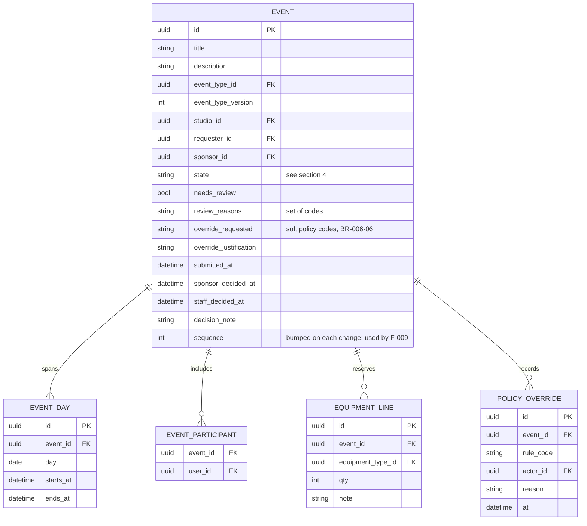
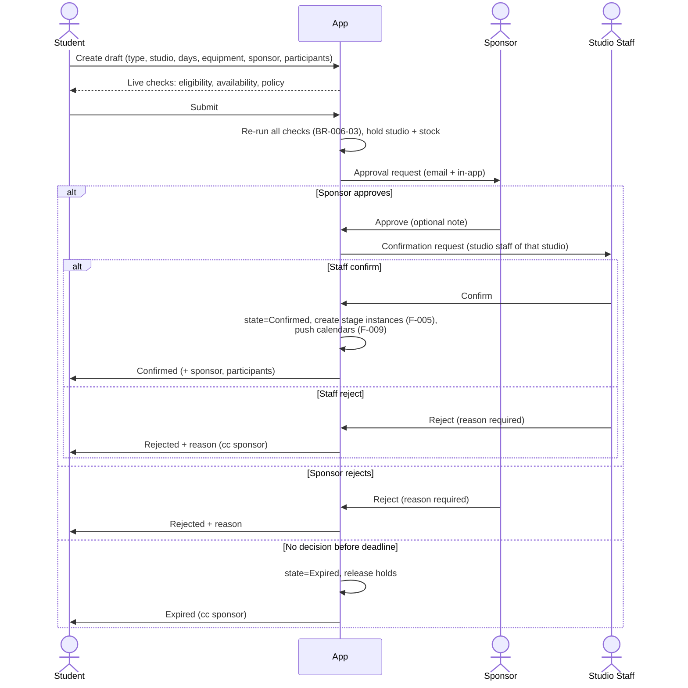
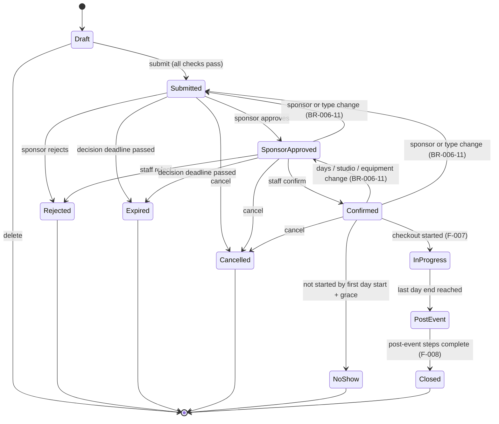
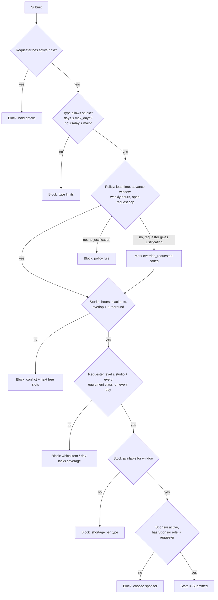

# F-006 — Event Booking and Approval

Status: Draft v0.1 · Depends on: F-001–F-005 · Used by: F-007, F-008, F-009, F-010

## 1. Purpose

Students request single-day or multi-day studio events, optionally with equipment. Every event needs a sponsor. It must be approved by the sponsor and then confirmed by studio staff (D-13) before it is booked.

## 2. Data model

## 3. Request flow

## 4. Event state machine

| State | Holds studio time | Holds equipment stock | Editable by requester |
|---|---|---|---|
| Draft | No | No | Yes |
| Submitted | Yes | Yes | Yes (changes trigger re-approval, BR-006-11) |
| SponsorApproved | Yes | Yes | Yes (BR-006-11) |
| Confirmed | Yes | Yes | Yes (BR-006-11) |
| InProgress | Yes | Yes (items are physically out) | No |
| PostEvent | No | Until checked in (F-007) | No |
| Closed / Rejected / Expired / Cancelled / NoShow | No | No | No |

`needs_review` is a **flag**, not a state. It can be set in Submitted, SponsorApproved, or Confirmed (reasons: `ELIGIBILITY_LOST`, `EQUIPMENT_SHORTAGE`, `STUDIO_BLACKOUT`, `OUTSIDE_HOURS`, `SPONSOR_INACTIVE`, `HOLD_ACTIVE`). Staff resolve it by editing the event, accepting it as-is with a reason, or cancelling it. `HOLD_ACTIVE` can only be resolved by clearing the hold or cancelling the event (BR-007-02).

## 5. Submission checks

## 6. Business rules

- **BR-006-01** An event has 1 to `event_type.max_days` event days, on **consecutive** calendar days (D-14). Each day has its own start and end, inside a single date (F-004 OQ-004-1).
- **BR-006-02** A sponsor is required. It must be an active user holding the Sponsor role, and not the requester (BR-001-11).
- **BR-006-03** All §5 checks run in the browser as the user edits (advisory only) and again on the server at submit, sponsor approval, staff confirmation, and checkout. The server result is the one that counts.
- **BR-006-04** **Concurrency.** Submitting takes the studio slot and stock in one transaction, so two simultaneous submissions cannot both get the last unit or the same slot. The second one fails with a conflict and gets fresh availability.
- **BR-006-05** **Policies** (Admin-configurable globally; can be overridden per studio):

  | Code | Rule | Default |
  |---|---|---|
  | LEAD_TIME | First day starts at least N hours after submission | 48 h |
  | ADVANCE | First day starts at most N days after submission | 60 d |
  | WEEKLY_HOURS | Total booked hours per student per ISO week, across events holding studio time | 10 h |
  | OPEN_CAP | Events per student in Submitted, SponsorApproved, or Confirmed | 3 |
  | SPONSOR_SLA | Hours for the sponsor to decide | 72 h |
  | STAFF_SLA | Hours for staff to decide | 48 h |
  | DECISION_CUTOFF | Event must be Confirmed this many hours before the first day | 24 h |
  | NO_SHOW_GRACE | Minutes after the first day's start before it counts as a no-show | 30 min |

- **BR-006-06** **Overridable policies.** LEAD_TIME, ADVANCE, WEEKLY_HOURS, OPEN_CAP, and `max_per_event` are soft rules. A requester who breaks one may still submit if they enter a justification. The event is then marked `override_requested` with those rule codes. Staff (for that studio) or an Admin must approve every requested override when confirming, which creates a POLICY_OVERRIDE record (reason, audited); otherwise they reject. Eligibility (levels), stock, studio overlap, decision cutoff, and holds are hard rules and **cannot** be overridden.
- **BR-006-07** An event is Expired when its SLA, or the DECISION_CUTOFF, passes without a decision, whichever comes first. Reminders go to the pending decision-maker at 50% and 90% of the SLA.
- **BR-006-08** Rejecting needs a reason, which is shown to the requester.
- **BR-006-09** Staff confirmation can be done by any Studio Staff of the event's studio, or an Admin. The first person to decide wins; everyone else's queue updates.
- **BR-006-10** Staff may edit equipment lines while confirming (e.g. offer a substitute type). Any change made there is shown to the requester in the confirmation notice.
- **BR-006-11** **Changes after submission:**
  - Changing the sponsor or event type sends the event back to **Submitted** (new sponsor approval).
  - Changing days, studio, or adding or increasing equipment sends a SponsorApproved/Confirmed event back to **SponsorApproved** (staff re-confirm). The sponsor is notified, but does not need to re-approve.
  - Removing or reducing equipment, editing the title or description, or changing participants needs no re-approval.
  - Every change increments `sequence` and re-pushes the calendars (F-009).
- **BR-006-12** Cancellation: the requester or sponsor can cancel any time before InProgress. Staff can cancel with a reason. Cancelling releases holds, cancels stage instances (BR-005-03), and removes calendar entries.
- **BR-006-13** A no-show is recorded when a Confirmed event is not started by first day start + NO_SHOW_GRACE. Staff mark it, and the system marks it automatically at the end of the first day. Remaining days are released. No-shows are counted per student per term for reporting (no automatic penalty in v1, OQ-006-2).
- **BR-006-14** A participant is shown on the event and gets calendar entries and read access to results. Participants do not need levels and cannot check out equipment.
- **BR-006-15** When an event moves to PostEvent, studio time after the end of the last day is released. Any days not yet reached stay held until the event finishes (InProgress ends only after the last day).
- **BR-006-16** Students see their events in a list grouped by state, with the next required action ("Waiting for sponsor", "Complete safety briefing", "Return equipment by …").

## 7. User stories

**US-006-01 — Single-day request**
- AC1: Given an eligible student with no holds, when they submit a 3-hour Podcast Recording in Studio A 5 days from now, with 2 SM7B mics, then the event is Submitted, the slot and 2 mics are held, and the sponsor is notified.

**US-006-02 — Multi-day request**
- AC1: Given a Thesis Production type (max 5 days), when a student submits Apr 10–12 with different hours each day, then 3 EVENT_DAYs exist, and stock is reserved from Apr 10 start to Apr 12 end.
- AC2: When the student selects Apr 10 and Apr 12 only, then submission is blocked: "Days must be consecutive."

**US-006-03 — Sponsor rejects**
- AC1: Given a Submitted event, when the sponsor rejects with reason "Wrong course", then the state is Rejected, holds are released, and the requester sees the reason.

**US-006-04 — Race for last unit**
- AC1: Given 1 FX6 available, when two students submit overlapping requests at the same moment, then exactly one is Submitted, and the other gets "No longer available" with refreshed availability.

**US-006-05 — Lead time override**
- AC1: Given a student submitting 36 h before start (LEAD_TIME 48 h) with justification "Reshoot approved by dept", then the event is Submitted with `override_requested=[LEAD_TIME]`.
- AC2: When Studio Staff confirm and approve the override with a reason, then a POLICY_OVERRIDE is recorded and the event is Confirmed.
- AC3: When the same student submits without a justification, then submission is blocked with the LEAD_TIME message.

**US-006-06 — Date change after confirmation**
- AC1: Given a Confirmed event, when the requester moves it a day later, then it returns to SponsorApproved, staff are asked to re-confirm, the sponsor is notified, and calendar entries are updated with the new times.

**US-006-07 — Expiry**
- AC1: Given a Submitted event with SPONSOR_SLA 72 h, when 72 h pass with no decision, then it is Expired, holds are released, and the requester and sponsor are notified.

## 8. Open questions

- OQ-006-1: Should a student be able to pick any sponsor, or only instructors of courses they're enrolled in? That would need instructors imported per course offering.
- OQ-006-2: Should repeated no-shows place a hold automatically (e.g. 2 per term)?
- OQ-006-3: Can staff create events for a student (walk-ins)? The matrix assumes only Admins can create on someone's behalf. Confirm.
- OQ-006-4: Is a waitlist needed when a slot is taken?
