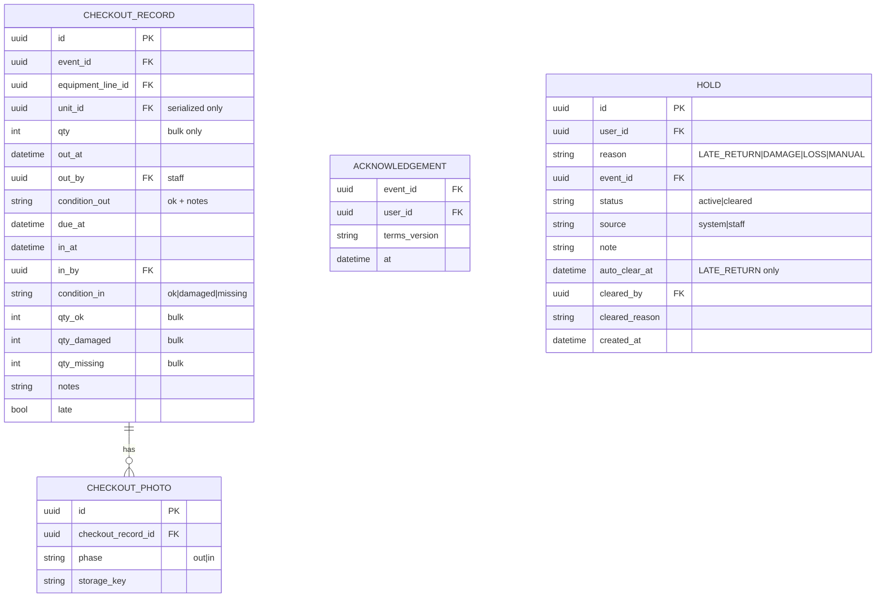
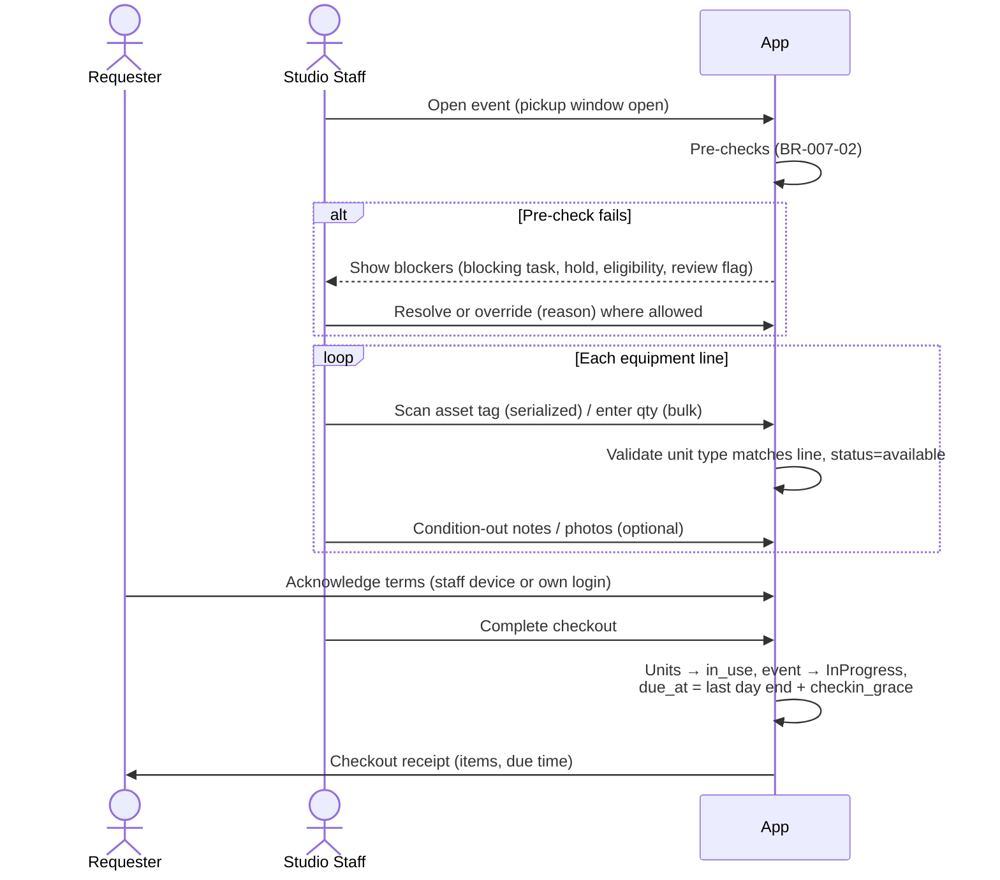
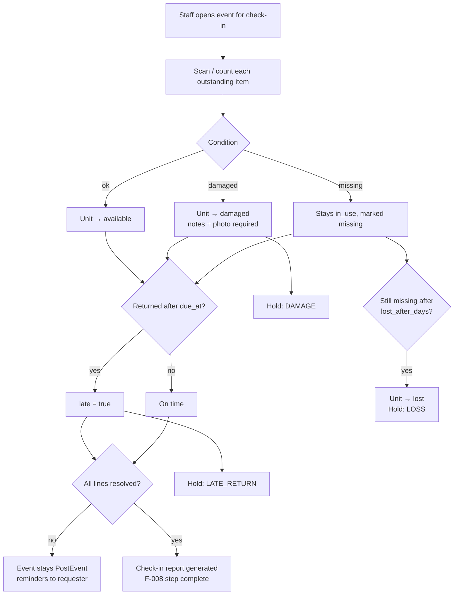
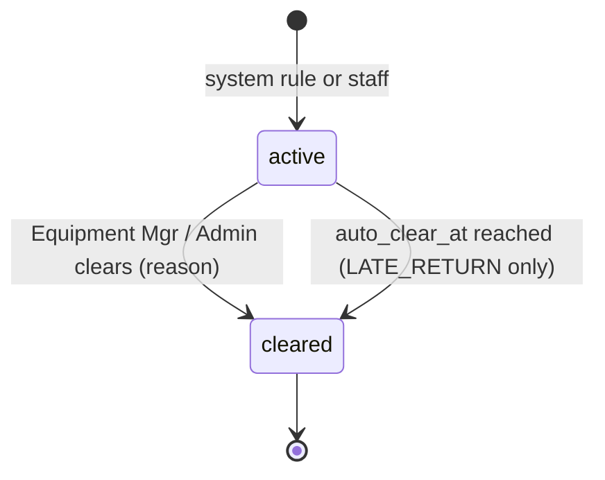

# F-007 — Equipment Checkout, Check-in and Holds

Status: Draft v0.1 · Depends on: F-003, F-005, F-006 · Used by: F-008

## 1. Purpose

Hand reserved equipment to the requester when the event starts, take it back afterwards and record its condition, and place a **hold** on the student's account when something is late, damaged, or lost (D-18).

## 2. Data model

## 3. Checkout

## 4. Check-in

## 5. Hold lifecycle

## 6. Business rules

- **BR-007-01** Checkout opens `pickup_window_minutes` before the first day's start. It can be done until the NO_SHOW cutoff (BR-006-13).
- **BR-007-02** **Pre-checks** at checkout:
  1. the event is Confirmed;
  2. `needs_review` is false, or staff resolve it now;
  3. no blocking task is incomplete, or staff override it (BR-005-05);
  4. the requester is eligible for every line on every remaining day (F-002);
  5. the requester has no active hold, or a Manager/Admin clears it (the hold itself cannot be overridden).
- **BR-007-03** An event with no equipment is still "started" by staff (a checkout with zero lines). This moves it to InProgress and avoids a NoShow.
- **BR-007-04** A scanned unit must be of the line's equipment type (or a component of the kit) and `available`. Staff may swap in another unit of the same type. Changing to a different type needs the line edited (counts as a change to the event, BR-006-10) and the requester's acknowledgement.
- **BR-007-05** Partial checkout is allowed. Lines that are not filled are recorded with a reason (`unit_unavailable`, `declined_by_requester`). Their reserved quantity is released.
- **BR-007-06** Only the **requester** can receive equipment. Participants cannot. Before each checkout, the requester accepts the current terms (version recorded).
- **BR-007-07** For event types with `daily_equipment_return=true`, each day has its own checkout and check-in. Each day's `due_at` is that day's end + grace.
- **BR-007-08** Check-in can be done by Studio Staff of the event's studio, or by an Equipment Manager. Equipment may be returned to any staff member at that studio.
- **BR-007-09** Damaged items need a note and at least one photo.
- **BR-007-10** **Automatic holds** (D-18):

  | Trigger | Hold reason | Clears |
  |---|---|---|
  | Any item returned after `due_at` | LATE_RETURN | Automatically 7 days after the last item is returned (configurable), or manually |
  | Any item checked in as damaged | DAMAGE | Manually, by Equipment Manager/Admin |
  | Item still missing `lost_after_days` (default 7) after due_at | LOSS | Manually |

  One hold per reason per event. Staff can also add MANUAL holds with a note.
- **BR-007-11** An active hold blocks new submissions (F-006 §5). It also flags the student's other events in Submitted, SponsorApproved, or Confirmed with `needs_review` reason `HOLD_ACTIVE`.
- **BR-007-12** When a hold is placed, the student and the event's sponsor are notified, with the reason and the item list. When it is cleared, the student is notified.
- **BR-007-13** Overdue reminders go to the requester at due_at, then daily until everything is returned (or marked lost). Studio staff get a daily overdue digest.
- **BR-007-14** Check-in is complete when every line is `ok`, `damaged`, or `lost`. Completing it generates the **check-in report** (items, condition out/in, timestamps, staff, photos, holds placed), which is attached to the result package (F-008).
- **BR-007-15** Scanning works with USB/Bluetooth barcode scanners (which act as keyboards) and with the device camera (QR/barcode) in the browser.

## 7. User stories

**US-007-01 — Standard checkout**
- AC1: Given a Confirmed event with 1 FX6 Kit and 4 XLR cables, when staff scan FX6-02 and its kit components, enter 4 cables, and the requester acknowledges the terms, then FX6-02 and its components become `in_use`, bulk XLR goes available −4 / in_use +4, and the event is InProgress.

**US-007-02 — Blocked by hold**
- AC1: Given the requester got a DAMAGE hold after their event was confirmed, when staff open checkout, then checkout is blocked with the hold details. Only a Manager/Admin clearing the hold unblocks it.

**US-007-03 — Late return**
- AC1: Given due_at Apr 12 19:00, when the items are checked in Apr 13 10:00 in good condition, then they become `available`, `late=true`, and a LATE_RETURN hold is placed with auto_clear_at Apr 20 10:00.

**US-007-04 — Missing becomes lost**
- AC1: Given 1 XLR cable missing at check-in, when 7 days pass after due_at, then the missing quantity moves to `lost`, a LOSS hold is placed, and the sponsor is notified.

**US-007-05 — Damage**
- AC1: When staff check in FX6-02 as damaged without a photo, then check-in for that line cannot be saved.

## 8. Open questions

- OQ-007-1: Should the requester sign at checkout (drawn signature), or is a recorded checkbox acknowledgement enough?
- OQ-007-2: Should LATE_RETURN holds get longer for repeat offences?
- OQ-007-3: Can a participant collect equipment if the requester delegates it?
