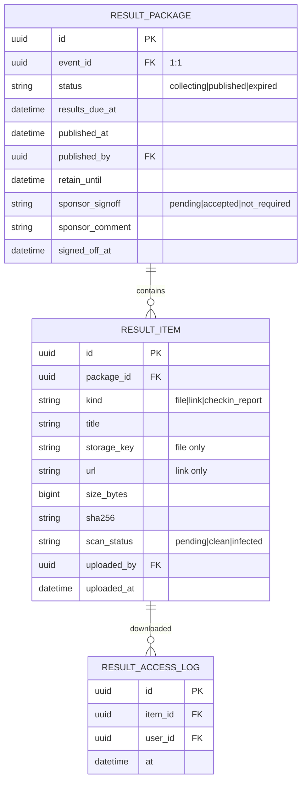
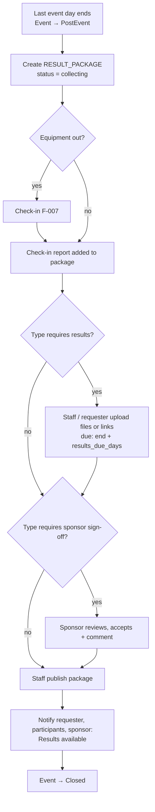
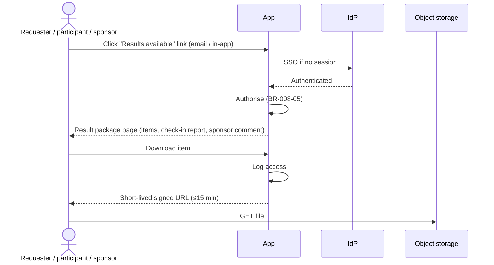
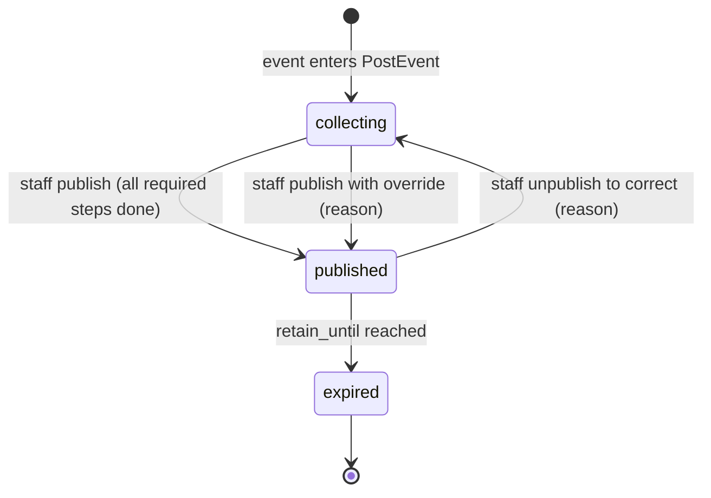

# F-008 — Post-Event Process and Results

Status: Draft v0.1 · Depends on: F-005, F-006, F-007 · Used by: F-010

> **Assumption D-11 (confidence 0.5).** "Results" is taken to mean a **result package**: the deliverable files or links from the session (recordings, exports, stills), the equipment check-in report, and the sponsor's sign-off/comment. Users retrieve it by logging in. If results means something else (e.g. grades), this spec has to be reworked. See OQ-1 in the overview.

## 1. Purpose

After an event's last day:

1. get all equipment back (F-007);
2. collect the session deliverables;
3. optionally get a sponsor sign-off;
4. publish the result package so authorised users can log in and get it.

The event type decides which steps are required (F-005).

## 2. Data model

## 3. Post-event flow

Steps that are not required are skipped. If none of the steps after check-in are required, the package is published automatically when check-in completes.

## 4. Retrieving results

## 5. Package lifecycle

## 6. Business rules

- **BR-008-01** Exactly one package per event, created when the event enters PostEvent.
- **BR-008-02** Studio Staff of the event's studio can upload and remove items while the package is `collecting`. The requester can too, if `requester_can_upload` is set on the event type. Participants cannot.
- **BR-008-03** Item limits (configurable): 10 GB per file, 50 GB per package. Allowed types: video, audio, image, PDF, ZIP. Every file is virus-scanned and cannot be downloaded until it is `clean`. A link item must be an https URL. Links to university OneDrive/Google Drive are encouraged for very large media (OQ-008-1).
- **BR-008-04** The check-in report (BR-007-14) is added automatically and cannot be removed.
- **BR-008-05** **Who can view** a published package: the requester, participants, the sponsor, Studio Staff of the studio, Equipment Managers, and Admins. Staff can view a `collecting` package; the requester can view it only if they are allowed to upload, and the sponsor only if the event type requires their sign-off (BR-008-06), so they can review the results before accepting.
- **BR-008-06** Sign-off: if required, the sponsor must accept before publishing. The sponsor gets a reminder at 3 and 7 days. After 14 days, staff may publish without it with a reason (`sponsor_signoff` stays `pending`, and this is visible on the package).
- **BR-008-07** Results due: if `requires_results` and nothing has been uploaded by `results_due_at`, staff and the requester get reminders every 2 days. Staff may publish an empty package with a reason.
- **BR-008-08** The event becomes **Closed** when the package is published **and** check-in is complete. An event with a LOSS still waiting for resolution can be Closed once the unit is marked `lost` and the hold is placed.
- **BR-008-09** **Retention.** `retain_until` = published_at + 365 days (configurable). 30 days before, the requester and sponsor are notified with a download reminder. At expiry, the files are deleted from storage; the metadata and check-in report are kept for audit.
- **BR-008-10** Every download is logged (RESULT_ACCESS_LOG). Signed URLs expire within 15 minutes and are tied to a single item.
- **BR-008-11** "My results" page: each user sees every package they can access, newest first, with how many days until it expires.

## 7. User stories

**US-008-01 — Results published**
- AC1: Given a Podcast Recording with equipment checked in and staff uploading 2 WAV files, when staff publish, then the requester and sponsor get "Results available" with a link, and the event is Closed.

**US-008-02 — Login to retrieve**
- AC1: Given a participant with no active session, when they click the results link, then after SSO they land on the package page and can download the files.
- AC2: Given a student who is not on the event, when they open the package URL, then they get 404 (no confirmation that the package exists).

**US-008-03 — Sponsor sign-off**
- AC1: Given a Thesis Production requiring sign-off, when staff try to publish before the sponsor accepts, then publishing is blocked, unless 14 days have passed and staff give a reason.

**US-008-04 — Retention**
- AC1: Given a package published Jan 1, 2027 with 365-day retention, when Dec 2, 2027 is reached, then the requester and sponsor get a 30-day warning. On Jan 1, 2028 the files are deleted and the package shows "Expired".

## 8. Open questions

- OQ-008-1: Where should large media be stored: in the app's object storage (cost, and the size limit above), or as links to university OneDrive or Google Drive? This decides storage cost and BR-008-03.
- OQ-008-2: Should there be a post-event survey or feedback form (requester rates the studio, staff rate the requester)?
- OQ-008-3: Should the sponsor's comment be private (visible to staff and sponsor only)?
- OQ-008-4: Is 365 days the right retention, given FERPA and storage cost?
