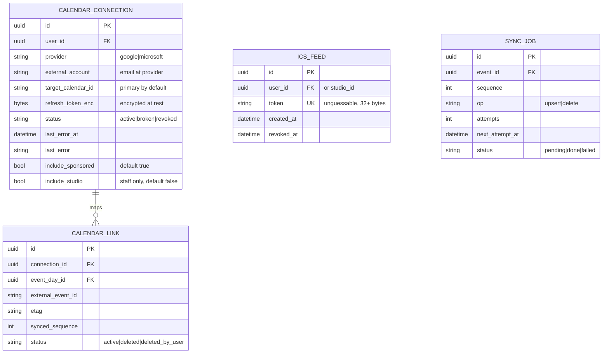
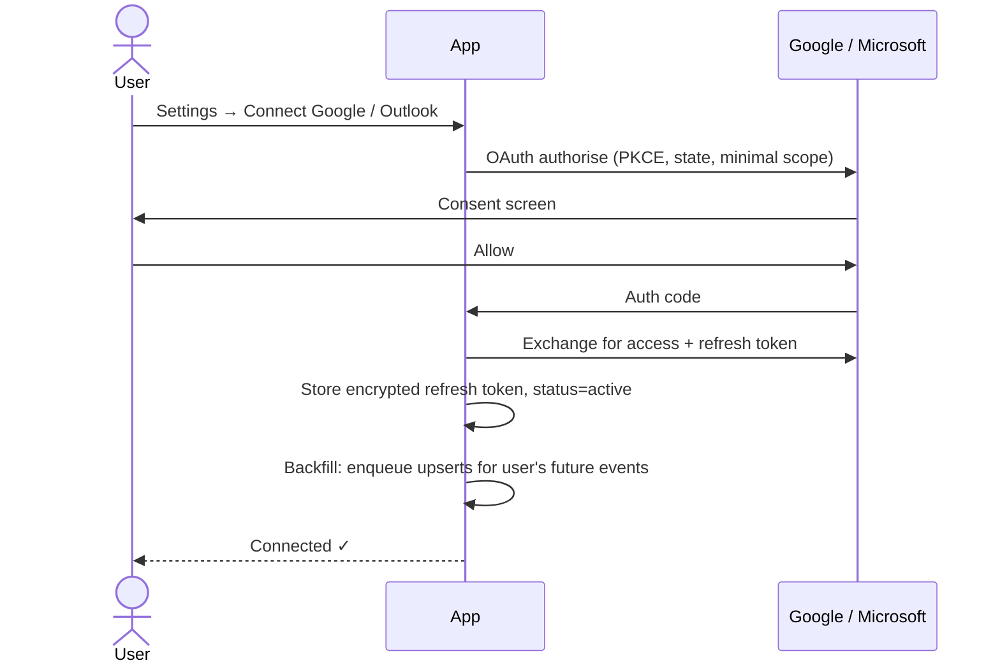
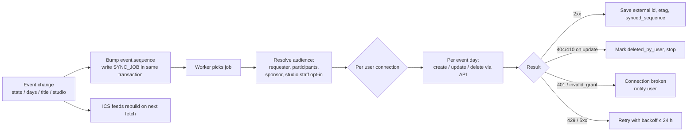

# F-009 — Calendar Sync (Outlook, Google, Apple)

Status: Draft v0.1 · Depends on: F-001, F-004, F-006 · Used by: —

## 1. Purpose

Put a user's studio events into the calendar they already use. Sync is **push-only** (D-08). This system is the source of truth, and edits made in external calendars are never read back.

| Provider | Mechanism | Latency | Confidence |
|---|---|---|---|
| Outlook / Microsoft 365 | Microsoft Graph API, delegated OAuth (`Calendars.ReadWrite`, `offline_access`) | Seconds | 0.9 |
| Google Calendar | Google Calendar API v3, OAuth (`calendar.events` scope) | Seconds | 0.9 |
| Apple Calendar (and any client) | Per-user ICS subscription feed (`webcal://`) | Set by the client. Apple: user-configurable, from about 5 min. Google-subscribed ICS: hours, up to ~24 h. | 0.75 |

Why ICS for Apple: Apple offers no public REST calendar API. Writing to iCloud means CalDAV with an app-specific password the user creates themselves, which is poor UX and a credential-storage risk. Not in v1 (OQ-009-3).

## 2. Data model

## 3. Connect an account

## 4. Sync pipeline

## 5. What is synced

| Event state | Requester | Participants | Sponsor | Studio staff (opt-in) |
|---|---|---|---|---|
| Submitted, SponsorApproved | Tentative, title prefixed "[Pending]" | — | Tentative | — |
| Confirmed, InProgress | Busy | Busy | Busy | Busy |
| Rejected, Expired, Cancelled, NoShow | Deleted | Deleted | Deleted | Deleted |
| PostEvent, Closed | Kept as-is (history) | Kept | Kept | Kept |

Calendar entry contents: title `"[{studio}] {event.title}"`; location = studio location; time = the event day's start and end; description = event type, sponsor name, pickup window, equipment summary, and a deep link to the event. The entry has **no** provider-side reminders by default (reminders come from F-005/F-010; this avoids duplicates). Users can enable them in their preferences.

## 6. Business rules

- **BR-009-01** One external calendar entry per **event day**, so multi-day events with different hours each day are shown accurately. The stable ICS UID is `{event_day_id}@{domain}`.
- **BR-009-02** Sync jobs are written in the same transaction as the event change (outbox). The worker is idempotent: if a link's `synced_sequence` is already ≥ the job's sequence, it does nothing.
- **BR-009-03** Updates use the stored external id. If a user deletes the entry in their calendar, the system does not recreate it (`deleted_by_user`). It is created again only if the event is rescheduled.
- **BR-009-04** A broken connection (token revoked or expired) notifies the user in-app and by email and offers reconnection. Jobs for that connection are paused, not dropped. Reconnecting runs a full backfill.
- **BR-009-05** Disconnecting revokes the token at the provider. The user chooses whether to remove the entries already pushed (default: remove).
- **BR-009-06** ICS feeds:
  - one personal feed per user (same audience rules as §5);
  - one feed per studio, staff-only (BR-004-09).
  
  The token is in the URL, so the feed is not behind login. Users can regenerate the token, which invalidates the old URL. The feed covers events from 30 days ago to 180 days ahead. Responses send `ETag`/`Last-Modified` and a `REFRESH-INTERVAL` / `X-PUBLISHED-TTL` of 15 minutes, which clients may ignore.
- **BR-009-07** ICS feeds and calendar descriptions include no other students' level, hold, or grade information. Participant names appear only in feeds of users who are on the event.
- **BR-009-08** Refresh tokens are encrypted with a KMS-managed key and never logged.
- **BR-009-09** Rate limiting: the worker stays under each provider's per-user and per-app limits, and treats 429 responses as a signal to back off.
- **BR-009-10** If the university uses Microsoft 365 or Google Workspace, an Admin can enable **tenant mode**: an admin-consented app-only credential writes to users' calendars without each user connecting. With Graph this needs an application access policy limited to the user group (OQ-4). Per-user connect remains available.

## 7. User stories

**US-009-01 — Google connect**
- AC1: Given a student with 2 confirmed events, when they connect Google, then 2 (or more, for multi-day) entries appear in their primary calendar within 1 minute.

**US-009-02 — Reschedule**
- AC1: Given a synced event, when it moves from Apr 10 to Apr 11, then the existing external entry is updated (not duplicated) for the requester, participants, and sponsor.

**US-009-03 — Apple feed**
- AC1: Given a student who subscribes to their feed URL in Apple Calendar, when an event is confirmed, then it appears after the client's next refresh. The settings page explains that updates are not instant.

**US-009-04 — Cancel**
- AC1: Given a Confirmed event synced to Outlook, when it is cancelled, then the Outlook entry is deleted.

**US-009-05 — Revoked token**
- AC1: Given a user revokes the app's access in their Google account, when the next sync runs, then the connection becomes `broken` and the user is notified with a reconnect link.

## 8. Open questions

- OQ-009-1: Should entries go in the user's primary calendar, or in a dedicated "Studio Bookings" calendar? A dedicated calendar needs a broader Google scope, or the newer app-created-calendar scope (confidence 0.6 that the latter fits).
- OQ-009-2: Google OAuth verification: if this is an "internal" Workspace app, no verification is needed. A public app using the `calendar.events` scope needs Google verification, which takes weeks. Which applies?
- OQ-009-3: Is iCloud CalDAV write support wanted in a later version?
- OQ-009-4: Should email invitations with `.ics` attachments (iTIP REQUEST/CANCEL) be added, as a faster fallback for Apple users?
