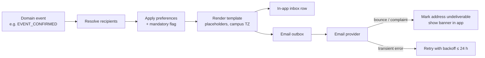
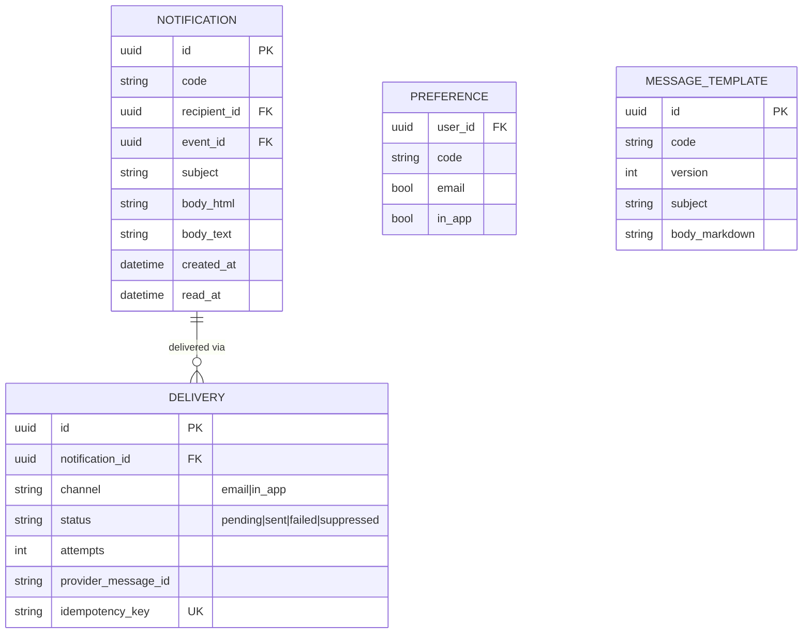

# F-010 — Notifications

Status: Draft v0.1 · Depends on: F-001 · Used by: F-002, F-005–F-009

## 1. Purpose

A single delivery service for every message the system sends: reminders and tasks (F-005), approvals (F-006), holds and overdue notices (F-007), results (F-008), and sync errors (F-009). Channels in v1 are **email** and an **in-app inbox** (D-16).

## 2. Delivery pipeline

## 3. Data model

## 4. Catalog

M = mandatory: the user cannot turn it off.

| Code | Trigger | Recipients | M |
|---|---|---|---|
| EVENT_SUBMITTED | Submit | Requester (receipt), sponsor (action) | ● |
| SPONSOR_DECISION_DUE | 50% / 90% of SPONSOR_SLA | Sponsor | ● |
| EVENT_SPONSOR_APPROVED | Sponsor approves | Requester, studio staff (action) | ● |
| STAFF_DECISION_DUE | 50% / 90% of STAFF_SLA | Studio staff | ● |
| EVENT_CONFIRMED | Staff confirm | Requester, participants, sponsor | ● |
| EVENT_REJECTED | Either rejection | Requester, sponsor | ● |
| EVENT_EXPIRED | SLA / cutoff missed | Requester, sponsor | ● |
| EVENT_CHANGED | BR-006-11 change | Requester, participants, sponsor, staff | ● |
| EVENT_CANCELLED | Cancel | Everyone on event, staff | ● |
| NEEDS_REVIEW | Flag set | Studio staff, sponsor | ● |
| STAGE_REMINDER | F-005 reminder due | Per stage template | |
| TASK_OPENED / TASK_DUE | F-005 task | Assignee | ● |
| CHECKOUT_RECEIPT | Checkout complete | Requester | ● |
| RETURN_OVERDUE | due_at passed, then daily | Requester; staff digest | ● |
| HOLD_PLACED / HOLD_CLEARED | F-007 | Student (+ sponsor on placed) | ● |
| GRANT_EXPIRING | BR-002-10 | Student, sponsor | ● |
| ROSTER_IMPORT_SUMMARY | Import done | Importer | |
| RESULTS_AVAILABLE | Package published | Requester, participants, sponsor | ● |
| RESULTS_EXPIRING | retain_until − 30d | Requester, sponsor | ● |
| SIGNOFF_DUE | F-008 | Sponsor | ● |
| CALENDAR_BROKEN | F-009 | User | ● |

## 5. Business rules

- **BR-010-01** Every notification creates an in-app inbox entry. Email is sent unless the user has turned off that code **and** it is not mandatory.
- **BR-010-02** Sending is idempotent per (code, recipient, event, stage instance or sequence). Retries and repeated jobs never produce duplicate emails.
- **BR-010-03** Emails contain no other students' private data (levels, holds, grades). Links require login; email links never carry login tokens.
- **BR-010-04** All times are shown in the campus time zone, with the zone abbreviation.
- **BR-010-05** Quiet hours apply to STAGE_REMINDER only (BR-005-10). Action and mandatory messages are sent immediately.
- **BR-010-06** Templates are versioned. Admins can edit subject and body. Changes are audited, and placeholders are checked when saving.
- **BR-010-07** Emails meet accessibility requirements: a plain-text alternative, real text instead of images of text, and descriptive link text.
- **BR-010-08** The sending domain uses SPF, DKIM, and DMARC alignment. Bounces and complaints are processed and recorded on the user.
- **BR-010-09** Staff can get daily digests instead of individual messages for STAFF_DECISION_DUE and RETURN_OVERDUE (a preference).

## 6. Open questions

- OQ-010-1: Should messages be sent from a university email domain (needs IT to set up DNS) or from a vendor subdomain?
- OQ-010-2: Is SMS wanted for overdue equipment in a later version?
